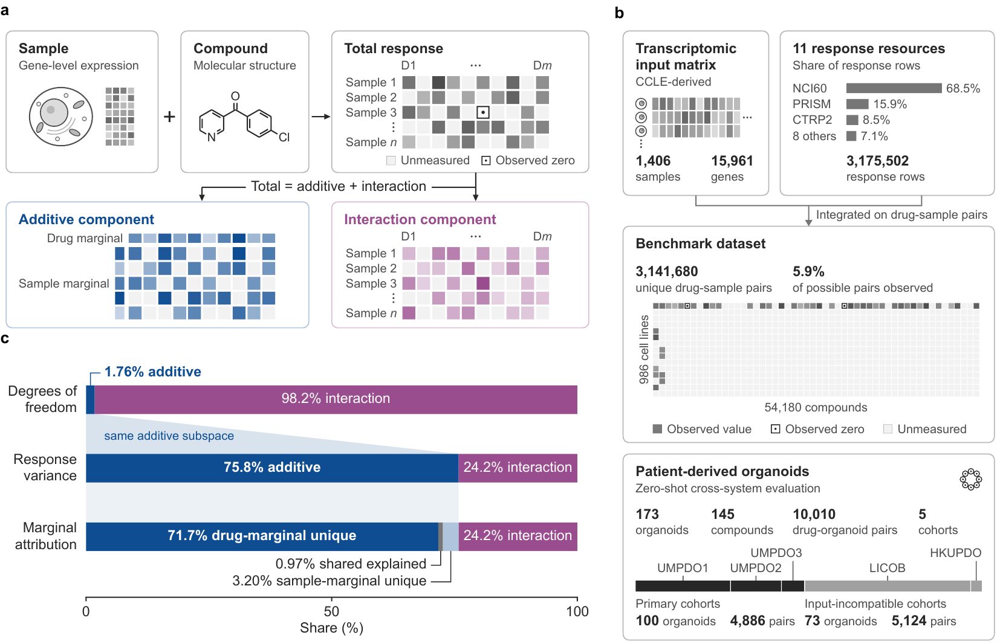

<a id="top"></a>

<div align="center">

<h1>DrugDis</h1>
<h3>Disentangling general and context-specific effects in drug-response prediction</h3>

<p>
  <a href="README.md"></a>
  <a href="README_zh-CN.md"></a>
  
  
  
  
  
  <a href="pyproject.toml"></a>
  <a href="LICENSE"></a>
</p>

<p>
  <a href="https://boom5426.github.io/DrugDis/">🌐 Project website</a> ·
  <a href="#quick-start">🚀 Quick start</a> ·
  <a href="https://huggingface.co/datasets/Boom5426/DrugDis">🤗 Data</a> ·
  <a href="#reproduce">🧪 Reproduce</a> ·
  <a href="manuscript/DrugDis_manuscript.pdf">📄 Paper</a> ·
  <a href="CITATION.cff">📚 Cite</a>
</p>

</div>

**DrugDis** decomposes measured and predicted drug responses on the same observed drug–sample pairs into **additive effects** (drug- and sample-wide tendencies) and **drug–sample interactions**, and scores each separately: direction, amplitude and error.

<table align="center" width="100%">
  <tr>
    <td align="center" width="25%"><h3>3,141,680</h3></td>
    <td align="center" width="25%"><h3>986</h3></td>
    <td align="center" width="25%"><h3>54,180</h3></td>
    <td align="center" width="25%"><h3>11</h3></td>
  </tr>
  <tr>
    <td align="center"><sub>drug–sample pairs</sub></td>
    <td align="center"><sub>cancer cell lines</sub></td>
    <td align="center"><sub>compounds</sub></td>
    <td align="center"><sub>response resources</sub></td>
  </tr>
</table>

<p align="center">
  <a href="assets/fig1.pdf"></a>
  <br>
  <sub>Figure 1 of the manuscript · <a href="assets/fig1.pdf">vector version ↗</a></sub>
</p>

### ✨ Key findings

- Additive effects account for **75.8%** of response variance across the benchmark dataset, and 59–83% within each of the five largest response resources (Fig. 1c).
- Under held-out cell lines, a model with a total-response correlation of **0.86** recovers interactions at only **0.32** (Fig. 1d).
- Matched component supervision improves interaction direction for held-out compounds and zero-shot organoids, but consistently reduces interaction error only for held-out compounds; organoid interaction R² stays **below zero** (Fig. 5b–d).
- Different evaluation criteria change which model is selected, without improving selectivity error on independent GDSC2 measurements (Fig. 5e–h).

<a id="quick-start"></a>

## 🚀 Quick start

```bash
git clone https://github.com/Boom5426/DrugDis.git
cd DrugDis
conda create -n drugdis python=3.11 && conda activate drugdis   # or any Python 3.11+ environment
python -m pip install -e .
python examples/decompose_demo.py
```

The demo scores three hypothetical predictors on a synthetic table (80 compounds × 120 samples, 30% of pairs observed). Its numbers illustrate the software, not the benchmark.

<details>
<summary><b>Expected output</b></summary>

```text
2,896 observed pairs, 80 compounds, 120 samples, 1 connected component(s)
additive component:     79.3% of response variance on 6.9% of the degrees of freedom
interaction component:  20.7% (corr with the additive component +4.6e-14)

                  marginals only + pair-level noise + half the interaction
rawPCC                     0.848              0.866                  0.946
sharedPCC                  0.952              0.990                  0.996
intPCC                 undefined             -0.022                  0.737
A_int                      0.000              0.356                  0.577
emits_interaction          False               True                   True
R2_interaction             0.000             -0.142                  0.518
MSE_raw                    0.396              0.346                  0.146
E_shared                   0.112              0.021                  0.009
E_interaction              0.285              0.325                  0.137

The first emits no interaction, so intPCC is undefined. The second emits
uninformative interaction and scores near zero. Only the third recovers it.
```

</details>

| Install | Command |
| :--- | :--- |
| Decomposition and evaluation API | `python -m pip install -e .` |
| Reproduce the paper (training, tables, data construction) | `python -m pip install -e ".[paper]"` or `pip install -r requirements.txt` |
| Tests | `python -m pip install -e ".[dev]"` |

The `paper` extra pins the versions of the reported analyses: NumPy 1.26.4, pandas 1.5.3, SciPy 1.15.1, scikit-learn 1.5.2, PyArrow 18.0.0, PyTorch 2.4.1 and RDKit 2023.09.4. The analyses used the CUDA 11.8 build of PyTorch; choose the build for your hardware.

<a id="system-requirements"></a>

### System requirements

| | |
| :--- | :--- |
| **Operating system** | Analyses: Ubuntu 22.04.5 LTS. Demo and tests also run on Ubuntu 26.04 LTS. Other systems are untested. |
| **Python** | API: 3.11 or later, tested on 3.11 with the `paper` pins and on 3.13 with NumPy 2.5.4, pandas 3.1.0 and SciPy 1.18.1. `paper` extra: 3.11 only, as pandas 1.5.3 has no wheels for later versions. |
| **Hardware** | API and demo: any CPU. Training: one CUDA GPU; the reported runs used an RTX 4090, about seven minutes per M0 run. |
| **Install time** | Fresh Python 3.11 environment, no package cache: core 11 s; `paper` and `dev` extras 176 s (5.6 GB). Depends on the connection. |
| **Demo run time** | Under one second (0.4 s on a desktop CPU). |

<a id="use-drugdis"></a>

## 🧭 Use DrugDis

<a id="decompose"></a>

### 🧮 Decompose response data

```python
import pandas as pd
from drugdis.evaluate import decompose

frame = pd.read_parquet("responses.parquet")   # one row per observed pair: SMILES, Sample_ID, Sensitivity
additive, interaction, summary = decompose(frame)
print(f"additive {summary['share_additive_pct']:.1f}% · interaction {summary['share_interaction_pct']:.1f}%")
```

Average repeated measurements of a pair first. Pass other column names explicitly, e.g. `decompose(frame, response="auc", drug="drug_id", sample="cell_line")`. The summary also gives the number of connected components and the dimension of the additive subspace, `n_drugs + n_samples - components`. Components are defined on the observed pairs: changing the compounds, samples or pairs changes them.

<a id="evaluate"></a>

### 🎯 Evaluate predictions

```python
import pandas as pd
from drugdis.evaluate import component_profile

test_frame = pd.read_csv("test_predictions.csv")   # one row per test pair: SMILES, Sample_ID, Sensitivity, prediction
scores = component_profile(test_frame, y="Sensitivity", yhat="prediction")
print(f"total {scores['rawPCC']:.3f} · additive {scores['sharedPCC']:.3f} · interaction {scores['intPCC']:.3f}")
```

Measured and predicted responses are decomposed by the same operator, built on the test pairs.

| Output | Question answered |
| :--- | :--- |
| **Total-response correlation** (`rawPCC`) | Does the prediction track the measured response overall? |
| **Additive-component correlation** (`sharedPCC`) | Does it recover the drug and sample marginals? |
| **Interaction-component correlation** (`intPCC`) | Does it recover which pairs deviate from the additive fit, and in which direction? |
| **Interaction amplitude and R²** (`A_int`, `R2_interaction`) | Is the predicted interaction as large as the measured one? |
| **Emission flag** (`emits_interaction`) | Does the prediction contain any interaction at all? |
| **Component errors** (`E_shared`, `E_interaction`) | Where does the squared error lie? The two sum exactly to `MSE_raw`. |

> [!NOTE]
> A prediction without an interaction component, such as a constant or a sum of drug and sample terms, has an undefined `intPCC`. As in the Methods, `component_profile` then returns `intPCC` as NaN and `emits_interaction` as `False` (`A_int` ≤ 1e-8, or `additive_by_construction=True` for a model that is additive by design). Uninformative interaction, such as shuffled predictions, still gets a defined score near zero.

<details>
<summary><b>Interpretation notes</b></summary>

A component correlation measures direction, `A_int` measures scale, and `R2_interaction = 2·A_int·intPCC − A_int²` combines them; it stays defined, near zero, for a prediction without interaction. Score each model on the pairs of its own test set: components on different sets of pairs are different quantities. Where pairs were measured twice, the per-component agreement of the two measurements (cross-assay reproducibility, table T03) is an empirical reference that model recovery can reach or exceed. The Methods of the [manuscript](manuscript/DrugDis_manuscript.pdf) give the definitions.

</details>

<a id="benchmark"></a>

## 🧬 Benchmark and evaluation settings

Responses come from eleven resources in the DROMA collection, as the DROMA field `Sensitivity`, used as supplied. Every cell line is represented by the same CCLE-derived expression profile over 15,961 genes.

| Evaluation setting | Samples | Compounds | Pairs | Role |
| :--- | ---: | ---: | ---: | :--- |
| **Cell-line benchmark** | 986 cell lines | 54,180 | 3,141,680 | Held-out-cell-line and held-out-compound evaluation |
| **Primary zero-shot organoid set** | 100 organoids | 78 | 4,886 | Primary cross-system evaluation (UMPDO1–3) |
| **All organoid cohorts** | 173 organoids | 145 | 10,010 | Sensitivity analysis; LICOB and HKUPDO are reported separately |

Organoids are not part of the benchmark dataset. They serve only for zero-shot evaluation of cell-line-trained checkpoints, without fine-tuning. UMPDO1 and UMPDO2 meet all three input-compatibility criteria, UMPDO3 (in the primary set defined before evaluation) misses the expression-level criterion by 0.005, and LICOB and HKUPDO fail all three. Each held-out axis has five split manifests; the M0, M1 and M2 comparisons use all five seeds, the representation benchmark the first three. In the code, M1 and M2 are M3 and M4 ([name map](PROJECT_STRUCTURE.md#names-in-the-code)).

GitHub holds the code, [split manifests](manifests/), [benchmark definition](configs/substrate_config.frozen.json) and [result tables](results/tables/README.md). The [Hugging Face dataset](https://huggingface.co/datasets/Boom5426/DrugDis) holds the processed inputs: the DROMA database, response and sample tables, CCLE-derived expression, ECFP4 and 22 pretrained molecular and transcriptomic representations; its card documents each file.

<details>
<summary><b>Download the dataset</b></summary>

```python
from huggingface_hub import snapshot_download

snapshot_download(
    repo_id="Boom5426/DrugDis",
    repo_type="dataset",
    local_dir="data_external/DrugDis",
)
```

Every analysis script finds its inputs and outputs through three environment variables ([`drugdis/paths.py`](drugdis/paths.py)):

```bash
export DRUGDIS_DATA=$PWD/data_external/DrugDis   # the dataset; required
export DRUGDIS_RUNS=$PWD/runs                    # training outputs (default ./runs)
export DRUGDIS_WORK=$PWD/work                    # analysis outputs and rebuilt tables (default ./work)
```

DROMA is archived at [doi:10.5281/zenodo.18503188](https://doi.org/10.5281/zenodo.18503188), with its input-data provenance at [doi:10.5281/zenodo.17498421](https://doi.org/10.5281/zenodo.17498421).

</details>

<a id="reproduce"></a>

## 🔁 Reproduce the paper

| Goal | Entry point | Inputs |
| :--- | :--- | :--- |
| **Try the software** | [Bundled demo](examples/decompose_demo.py) | Repository only |
| **Inspect paper results** | [Result-table index](results/tables/README.md) | Committed canonical tables |
| **Rerun analyses** | [Launchers](scripts/) and the commands below | Hugging Face dataset; one CUDA GPU for training |

Run the tests with `python -m pip install -e ".[paper,dev]"` and then `pytest`.

<details>
<summary><b>Paper-level commands</b></summary>

```bash
# 1. Processed inputs (optional: the dataset already contains them)
python drugdis/data/build_processed_tables.py --out "$DRUGDIS_DATA"
python drugdis/data/build_gdsc_sensitivity.py --out "$DRUGDIS_DATA/gdsc_sensitivity_data.parquet"
python drugdis/data/encode_ecfp4.py --out "$DRUGDIS_DATA/Molecule_Embeddings/ECFP4_emb2048.pickle"
python drugdis/data/build_ccle_substrate.py
python drugdis/data/align_all_gene_reps.py

# 2. Benchmark dataset and split manifests
python drugdis/splits/verify_frozen.py            # inputs and manifests against recorded checksums
bash scripts/make_manifests.sh                    # rebuild the manifests into $DRUGDIS_WORK/manifests

# 3. Training (one M0 run takes about seven minutes on an RTX 4090)
bash scripts/train_m0_m4_lclo.sh                  # M0 and M2 (code M4), held-out cell lines, 5 seeds
bash scripts/train_m0_m4_lso.sh                   # M0 and M2 (code M4), held-out compounds, 5 seeds
bash scripts/train_m3.sh                          # M1 (code M3), both regimes, 5 seeds
bash scripts/run_benchmark.sh                     # representation benchmark, 3 seeds
bash scripts/decoder_matrix.sh && bash scripts/decoder_penalty_sweep.sh && bash scripts/decoder_confirm.sh

# 4. Every canonical table, compared with results/tables by SHA-256
bash scripts/reproduce_tables.sh
```

[`configs/substrate_config.frozen.json`](configs/substrate_config.frozen.json) defines the benchmark dataset: a pair is eligible if its sample is a cell line with a CCLE expression profile outside the excluded Tavor project and its compound has an ECFP4 fingerprint; repeated measurements are averaged, and `build_processed_tables.py` applies the overlap rule of the Methods. M0, M1, M2 and the representation benchmark train with batch size 2,048, 30 epochs, learning rate 1e-4, dropout 0.4 and weight decay 1e-5, and are reported at `best_valmse.pth`, the epoch with the lowest validation error. The decoder analysis uses the feature standardization and validation-selected regularization given in the manuscript. [PROJECT_STRUCTURE.md](PROJECT_STRUCTURE.md) describes the layout.

</details>

<details>
<summary><b>Reproduction checks of this release</b></summary>

Run on the analysis host on 2026-09-29, with this code, the processed data and the reported training runs:

- **Split manifests.** `scripts/make_manifests.sh` rebuilds all ten manifests byte for byte; `verify_frozen.py` passes 34 of 34 checksums.
- **Tables.** `scripts/reproduce_tables.sh` rebuilds 23 of the 24 canonical tables byte for byte. T10 matches in every value; only its `prediction_sha256` column differs, because gzip stores the write time of each prediction export. Built from the original exports, T10 is byte-identical. The numerical consistency checks pass 57 of 57.
- **Training.** One epoch of M0 and M2 (held-out cell lines, seed 3407) and of M1 (held-out compounds, seed 3407) reproduces the first epoch of the reported runs exactly. Full retraining was not repeated.
- **Processed inputs.** The data scripts rebuild every processed input exactly, except two NCI60 organotin compounds whose `[Sn-]` SMILES RDKit 2023.09.4 rejects (109 response rows, 2 fingerprints); neither is in the benchmark dataset.
- **Unit tests** pass.

</details>

> [!IMPORTANT]
> Released: the code, the canonical result tables, the manuscript and the Supplementary Information. Not released: figure-drawing code, model checkpoints and prediction exports. The overview figure is a static excerpt of Figure 1.

<a id="citation"></a>

## 📚 Citation

Please cite the [manuscript](manuscript/DrugDis_manuscript.pdf) ([Supplementary Information](manuscript/DrugDis_SI.pdf)) when using DrugDis or its benchmark dataset. Metadata: [`CITATION.cff`](CITATION.cff).

<details>
<summary><b>BibTeX</b></summary>

```bibtex
@article{Li2026DrugDis,
  title  = {DrugDis: Disentangling general and context-specific effects in drug-response prediction},
  author = {Li, Bo and Liu, Chengliang and Peng, Yuzhong and Zhang, Bob and Wang, Qing and
            Zeng, Pinxian and Li, Mengran and Huang, Shenghui and Deng, Chuxia and Zhang, Yang},
  year   = {2026}
}
```

</details>

**License.** Code: [MIT License](LICENSE). Data on Hugging Face: CC BY 4.0, except the pretrained-model embeddings, which keep the terms of the models that produced them; the upstream response and omics resources keep their own terms. The [dataset card](https://huggingface.co/datasets/Boom5426/DrugDis) lists each. Questions and bug reports: [open an issue](https://github.com/Boom5426/DrugDis/issues).

<p align="center"><sub><a href="#top">Back to top ↑</a></sub></p>
